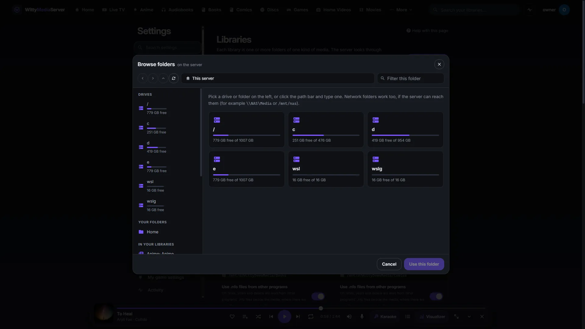

# WittyIntegratedFileBrowser

Lets you choose a server's folders from any device. A browser's own folder window only sees the device it runs on, so without this a phone or a TV can't pick folders on the server, and you type the path instead.

It's a module of [WittyMediaServer](https://github.com/wittywilla/WittyMediaServer) ([wittymediaserver.com](https://wittymediaserver.com)): the server runs it as a helper program, and its web part is the folder window in the app. This version is built for module API 5, the only one WittyMediaServer 0.8.0-alpha takes.

<!-- pictures -->



<sub>Browsing the server's folders from the browser.</sub>

<!-- /pictures -->

## What it does

- **Places:** drives with their label and free space, Home, Videos, Music and the rest, plus places an app adds, such as folders already in use.
- **Getting around:** back, forward, up, a clickable path that turns into a text box (network paths too), and recently chosen folders.
- **Seeing what's there:** files with their kind, DVD and Blu-ray folders marked, sizes, dates, a count of what's inside, and hidden items on request. A very large folder stops at 3,000 entries unless the app sets another limit.
- **Choosing:** the folder you're in, or tick several and use them all.
- **Every way of using it:** keyboard (arrows, Enter, Space, Backspace, `/` to filter, Ctrl+L for the path), touch, mouse and screen readers, with a full-screen layout on phones.
- **In Docker and other containers:** when a folder can't be opened, or a mount point looks empty, it says which user and group the server runs as and who owns the folder, with a link to fixing it on UGREEN, Synology, QNAP, Unraid, TrueNAS SCALE, Asustor or plain Linux. Outside a container it says nothing of the kind.
- **It only reads.** Nothing is created, renamed or deleted.

The folder window in the app, and naming what kind of media each file is, stay with the server. If a version can't read a folder, the server tries it itself.

How to use it is in **Help** inside WittyMediaServer: see Getting started.

## How to get it

An admin adds it from the module store inside WittyMediaServer: **Settings → Modules**, then **Browse the store**, then **Add** beside WittyIntegratedFileBrowser. This version is built for module API 5 and fits WittyMediaServer 0.8.0-alpha through 0.8.x, as its `module.json` says. It works with nothing older: the server takes module API 5 only.

## What it needs

[WittyModule](https://github.com/wittywilla/WittyModule), which is how a server talks to it, and `golang.org/x/sys`, both built in. The window in `web/` is React and uses the app's theme. It's written in Go with no cgo.

If you use it in another app, put the Go half behind that app's sign-in.

## Platforms

A program is built for each system below, and the server uses the right one.

| System | Where it stands |
|---|---|
| Linux (x64, arm64, 32-bit ARM, x86) | Its tests pass on x64. The other CPUs are only built |
| Windows (x64, arm64) | Built. This version hasn't been run on Windows since it became its own program |
| macOS (Intel, Apple silicon) | Built by the release tool. It has not been run on a real Mac |
| FreeBSD (amd64, arm64) | Cross-compiled only. It has not been run |

On macOS and FreeBSD the server has no sandbox for a module's helper: it gets a small environment and a soft memory limit, and nothing more.

The window is one browser bundle for every system.

## Building and testing

You need Go 1.26 or newer. In a worktree, first run the copy of `dev-modules.mjs` kept above the repositories (`node D:/projects/dev-modules.mjs` on the development machine). It writes a `go.work` that git ignores, so the checkout builds against the repositories beside it. Never run `go work use`.

```bash
go vet ./...
```

```bash
go test ./... -count=1
```

```bash
go run github.com/wittywilla/wittymodule/cmd/wittymodule check .
```

The last one checks the manifest. On the same tool, `pack -targets linux/amd64 -out release .` builds a release for one system. CI also builds for every system.

The browser half builds with Node.js:

```bash
npm install
```

```bash
npm run build:bundle
```

It is built by WittyModule's one builder (`kit/web/build-bundle.mjs`), found at `../WittyModule` or wherever `WITTYMODULE` says.

To use it in another app, `Places(extra...)` says where to start, and `List(path, Options)` gives a folder's folders and files, with `ErrNotFound` and `ErrDenied`. Serve both as JSON for the React window in `web/`, which takes `list`, `onPick` and `onClose`. When a folder can't be read, `Explain(path)` (the helper's `access` call) says why in a container, or nil; send it as `access` beside the listing, or in the error's data, and the window shows it. The checks that need a container and another user are in [docs/TESTING.md](docs/TESTING.md).

## Module API 5, and every app

It is built for module API 5 (WittyMediaServer 0.8.0-alpha through 0.8.x), and carries `integration.json` beside `module.json` and `sdui.json`. It claims no routes, data or lifecycle: the server keeps its folder route, `GET /api/fs`, calls this helper's `places` and `list` itself, checks every answer against the folder asked for, and names what kind of media each file is. Without this module, a folder's path is typed instead. The web part exports `register(host)`, which claims nothing yet (WittyModule 0.5.2 has no hook for a folder picker), and its default export is the folder window that Settings, Libraries opens.

Its `sdui.json` is written from Go (`ui/ui.go`; `go test ./ui -update-sdui` writes it, and `go test ./ui` fails when it's out of date), so every app draws its screens natively, a TV's included:

- **Server folders** (page `wittyintegratedfilebrowser`, under More in the menu, for administrators only): the server's drives and usual folders, each opening its folder; opened with `?name=<a folder's path>`, where the folder is, Up, its folders (each opening its own page) and its files with their sizes. Read-only, and a folder on another machine (`\\nas\share`) is never opened. Anyone else sees a note that it's for administrators.
- Data sources its helper answers (`sdui.items`), for administrators only: `wittyintegratedfilebrowser.places`, the drives and usual folders with the space left on each (offered in the page editor's gallery as **Server drives and space**), and `wittyintegratedfilebrowser.folder` (`path`), one folder.

**Stays in its own code:** the folder window itself (places, filter, multi-select, disc folders marked, and help when a folder can't be read).

The files are checked with `wittymodule check` and described in WittyMediaServer's [docs/MODULES-API5.md](https://github.com/wittywilla/WittyMediaServer/blob/master/docs/MODULES-API5.md) and [docs/SDUI-MODULES.md](https://github.com/wittywilla/WittyMediaServer/blob/master/docs/SDUI-MODULES.md).

## Licence

GNU Affero General Public License v3.0 (or later): see [LICENSE](LICENSE) and [NOTICE](NOTICE). If you redistribute it or build on it, please keep the NOTICE attribution. Each release archive carries a `THIRD-PARTY-NOTICES.txt` for what its programs link.

<!-- module-kit -->
## Releasing

A version tag builds a program for every platform, signs the checksum list, and publishes a release that servers can install.

Versions move in small steps as work lands. `go run github.com/wittywilla/wittymodule/cmd/wittymodule@v0.5.4 bump .` raises it
everywhere it is written (add `-part minor` for a bigger step). A bump isn't a release: nothing is
tagged or published until you tag it. CI fails when code changed since the last tag and the version
didn't, because tags never move.

To release:

1. Check that `version` in `module.json` is the one to publish, with the bump committed.
2. Tag that commit and push the tag: `git tag vX.Y.Z`, then `git push origin vX.Y.Z`. A tag with a
   suffix, such as `v1.2.0-beta`, is published as a prerelease.
3. Watch the *Actions* tab. The signing step uses the `WMS_SIGNING_KEY` secret of the `release` environment, and nothing is published without it.

To take a version back, run the *withdraw* workflow from the *Actions* tab. It adds the version to a signed list on the release tagged `withdrawals`, which servers read.

Licensed under AGPL-3.0-or-later: see [LICENSE](LICENSE) and [NOTICE](NOTICE).
<!-- /module-kit -->

## Legal

WittyIntegratedFileBrowser is an independent open-source project. It isn't associated with,
sponsored by or endorsed by any publisher, rights holder, service or other media software project.
It lists folders on the machine it runs on, and doesn't provide or check what's in them. Any
third-party names here only describe what it works with, and belong to their owners. It's provided
“as is”, with no warranty; see [LICENSE](LICENSE). Local law applies to how you use it. This isn't
legal advice.
